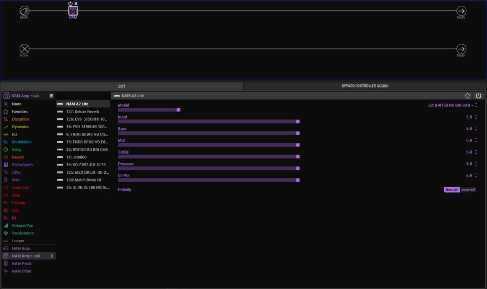

# Floor editor setup and compatibility

Updated November 12, 2026. This is the installation entry point shared by both maintainers.

## Which versions?

| Component | Current source-preview baseline |
| --- | --- |
| Floor firmware | HX Unbound Floor's normal NAM A2 Lite model contract on Helix Floor 3.80.0: HD2_AmpNAMLite, preset ID 380 |
| Stock desktop installation | Windows HX Edit 3.82 with Line 6 drivers |
| Floor editor source | [f72e7afd9ef073ef1b890fd9ad819bc9d97d0a1e](https://github.com/Suddl3/hx-edit-nam/tree/f72e7afd9ef073ef1b890fd9ad819bc9d97d0a1e); current `floor` branch adds setup docs |
| Converter source | [andreidevs/helix-lt-nam at c94834768546393420692794fdbb27c9cc31d718](https://github.com/andreidevs/helix-lt-nam/tree/c94834768546393420692794fdbb27c9cc31d718) ΓÇö tools only; do not flash LT firmware onto a Floor |
| Python packages | frida 17.5.2 and msgpack 1.2.4 in a virtual environment |
| Browser/helper | Microsoft Edge WebView2 Runtime and Windows .NET Framework compiler |

The default Floor builder uses the free preset ID 380. **Do not use this preview with the experimental NAM_555 / --e555 variants, changed parameter layouts, shortened-layer models or NAM Pedal without a separate compatibility change.** The unrelated `--hx-nam` mode is not a way to turn this Floor library into a 555-compatible editor.

PAIR layout, names, DSP-cost experiments and the opt-in screen mirror are firmware choices; their presence alone does not change the editor's eight-parameter contract. Keep the normal builder's defaults unless following the corresponding documented experiment. Cost 3250 evidence applies to PAIR; the default cost remains 3600. Close HX Edit before any direct-USB mirror or research tool.

## Install from source on Windows

Install official HX Edit 3.82 with drivers, Python 3.10+ (64-bit), Git, and WebView2 Runtime first. Close other HX Edit instances. Run the following in a new working folder:

```powershell
git clone --branch floor https://github.com/Suddl3/hx-edit-nam.git
git clone https://github.com/andreidevs/helix-lt-nam.git
git -C helix-lt-nam checkout c94834768546393420692794fdbb27c9cc31d718
cd hx-edit-nam
py -3 -m venv .venv
.\.venv\Scripts\python.exe -m pip install frida==17.5.2 msgpack==1.2.4
.\.venv\Scripts\python.exe .\start-hx-edit-nam.pyw --floor-library
```

The two repositories must be adjacent. The converter checkout supplies `tools/nam2ir.py`; its LT firmware is not installed by these commands. The editor composes its working copy locally from your own HX Edit installation and builds its helper; the first browser launch may download the WebView2 SDK.

Expected stock Windows HX Edit executable SHA256:
`f7faac4996164f9039c9ae3ca8d85cd135c5bceae8a511c8921a1244046cab66`.

For a reproducible code snapshot, check out the full editor SHA in the table above. Do not install an upstream release ZIP expecting it to contain this fork's Floor-library changes.

## The navigation branch

The `floor-navigation` branch is the newer editor: a Browse TONE3000 button in the banner, the rich NAM tab with Load on Floor / Use on Floor, previews that put the original capture back, and no slot scan after the first launch. It is a test build. What has run on a Floor and what has not is listed in [FLOOR-WORKFLOW.md](FLOOR-WORKFLOW.md#status-november-13).

Same prerequisites as above. In a new working folder:

```powershell
git clone --branch floor-navigation https://github.com/Suddl3/hx-edit-nam.git
git clone https://github.com/andreidevs/helix-lt-nam.git
git -C helix-lt-nam checkout c94834768546393420692794fdbb27c9cc31d718
cd hx-edit-nam
py -3 -m venv .venv
.\.venv\Scripts\python.exe -m pip install frida==17.5.2 msgpack==1.2.4
$env:T3K_PUBLISHABLE_KEY = "t3k_pub_your_own_key"
.\.venv\Scripts\python.exe .\start-hx-edit-nam.pyw --floor-reference --navigation
```

### Updating an existing clone

Close HX Edit first. In your `hx-edit-nam` folder:

```powershell
git fetch origin
git checkout floor-navigation
git pull
$env:T3K_PUBLISHABLE_KEY = "t3k_pub_your_own_key"
.\.venv\Scripts\python.exe .\start-hx-edit-nam.pyw --floor-reference --navigation --nam-category
```

Nothing else needs reinstalling: the launcher rebuilds its working copy of HX Edit on every start. Leave off `--nam-category` to run without the NAM categories. Your library and remembered slots in `%LOCALAPPDATA%\HX Edit NAM` are kept.

### The NAM categories (`--nam-category`)



With `--nam-category` the block selector gains four categories under a thin line after Looper. Each lists the NAM A2 Lite block and the captures of that type that are on the Floor; picking one sets the block to it, and the block in the signal path takes the icon of its capture's type. A capture's type is the one shown in the NAM tab; changing it there moves the capture at once. A padlock left of the Model value locks a NAM block's capture against accidental changes (click it to unlock). What has been seen working and the known flaws are in [FLOOR-WORKFLOW.md](FLOOR-WORKFLOW.md#nam-categories-in-the-block-selector-opt-in---nam-category).

### Notes

- Launch with `--floor-reference --navigation` every time. `--floor-library` belongs to the older `floor` branch.
- The TONE3000 key is your own Publishable Key. Without it the NAM tab and local library still work; Browse TONE3000 does not.
- The first launch builds the two helper windows with the Windows .NET Framework compiler and downloads the WebView2 SDK package it needs. The first time you open the NAM tab, every occupied User IR slot is read back once (about half a second each, with HX Edit locked). Later launches skip slots whose name has not changed.
- **User IR 128 is the preview slot.** A preview replaces whatever is in it. Do not keep an IR of your own there.
- Your captures are kept in `%LOCALAPPDATA%\HX Edit NAM\NAM Library`, with `catalog.json`, a `catalog.json.bak` and `floor-memory.json` (remembered slots and the preview in progress).
- The maintainer's own testing used a packaged copy built from this same source, not this command line. The source launch above uses the same code path but has not been run on a second machine yet. Report what you see.

## Launch again

Close other editors, then run the last command from the same `hx-edit-nam` folder. Use `--floor-library` every time; the generic upstream launch is a different mode.

The retained local library is under `%LOCALAPPDATA%\HX Edit NAM\NAM Library`. Copy that directory if moving your library between PCs. The repository does not contain anyone's captures or installed-slot assignments.

For TONE3000, use your **own Publishable Key and sign-in**, following the [upstream TONE3000 setup](README_UPSTREAM.md#tone3000). Never share a Secret Key, password or another user's browser profile.

## First collaborator check

Use a spare preset and low monitoring. Confirm the editor recognizes the existing NAM block and its Model/Input values before editing. Check all four tabs and sidebar resizing, one library Load/Use, two previews and cleanup, then physical audio/joystick response. Leave the preset unsaved for this first pass. An active USB connection alone is not proof of a responsive panel.

Stock HX Edit export/backup has previously omitted NAM data. Do not overwrite a known-good NAM backup or assume a stock restore preserves custom blocks.

## What has actually been verified?

- The development Candidate 53 lineage passed owner checks for tabs/resizing and the earlier library, preview and Clear workflows.
- Published reconciled source `f72e7af` passed the portable offline suite (81 passed, 5 proprietary-fixture skips), composition/build checks and tab-order regressions. It was not revalidated as this exact source/firmware pair on every unit.
- Later local navigation Candidates 54ΓÇô57 introduced separate regressions and are withdrawn. This setup deliberately does not point to them.
- Newly merged firmware source is not a request to flash it. See the [firmware status and build notes](https://github.com/Suddl3/hx-unbound-floor) for each feature's evidence.

## Updating

Use the `floor` branch and this setup page as the maintained channel. Before pulling, preserve local work and library data. Follow explicit source/version guidance; do not automatically merge upstream `main` or use `git reset --hard` to update.

Maintainers compare upstream changes before each integration batch, preserve the rich sidebar and cleanup/slot-protection behavior, and publish updated compatibility notes. A downloadable Floor installer and the new dockable navigation workflow are still future work.
