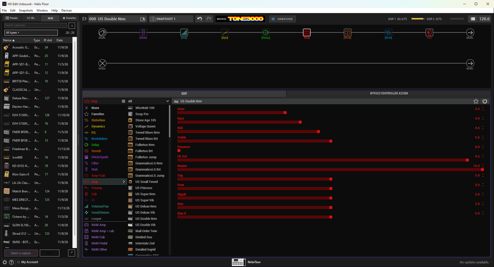
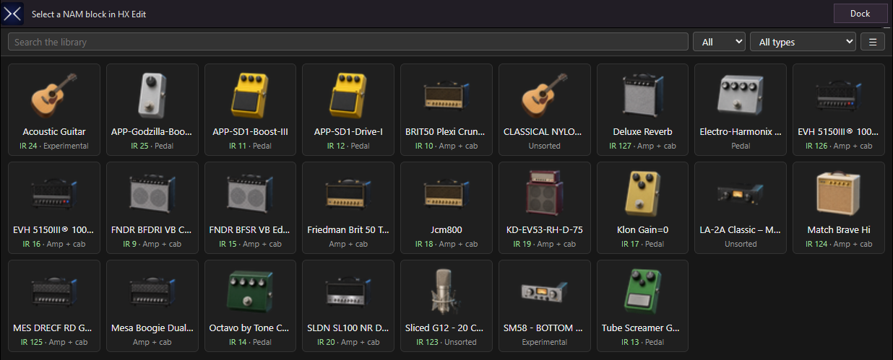
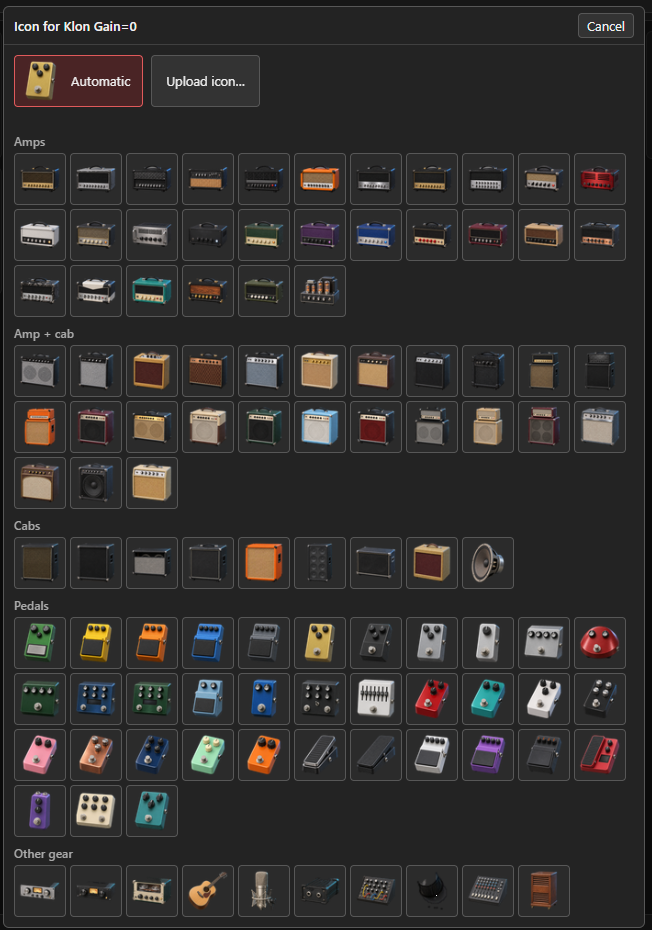
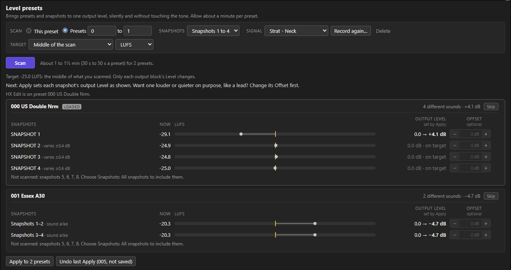
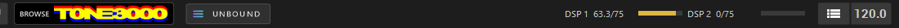

# HX Edit Unbound

**Part of [HX Unbound](https://github.com/Suddl3/hx-unbound).** HX Edit Unbound is Line 6's own HX Edit with HX Unbound's additions for the Helix Floor: a NAM capture library with gear artwork, TONE3000 browsing and previews, a DSP meter and Level presets. It pairs with [HX Unbound Floor firmware](https://github.com/Suddl3/hx-unbound-floor).

> **A test build.** It runs on Windows with HX Edit 3.82 and has been exercised on one Helix Floor by one maintainer. See [what has and has not been tested](docs/FLOOR-WORKFLOW.md#status-november-14).

## How it behaves differently from stock HX Edit

Some of HX Edit's own controls work differently here. None of this changes your presets or the Floor until you act, and every change on the chain can be undone with Undo.

**Every launch**

- **The IR list drags differently.** Drop a slot on the middle of a block to replace that block (stock HX Edit only inserts). Drop on a block's edge to insert beside it, as before. The block that would be replaced dims while you hover, and blocks slide aside a little faster.
- **NAM slots become NAM blocks.** A NAM capture slot dragged or double-clicked from the IR list makes a NAM block on that slot, not an IR block. NAM slots show in violet in the IR list (switch this off in the HX Unbound menu).
- **Drag captures onto the chain** from the NAM tab or the library window. On a NAM block, it changes the capture. On an empty cell or another block, that cell becomes a NAM block.
- **A NAM block is only added where the DSP has room.** Drag a capture over a DSP that cannot fit another NAM block and its picture goes grey with a red outline and "Not enough DSP room here". A drop there changes nothing, and the DSP meter says which DSP is full.
- **Clearing an IR slot asks first** when presets you have opened still use it.
- **The window keeps its size and place** when the Floor reconnects.

**With the NAM categories (`--nam-category`), in the block picker**

- **One click selects; it does not change the block.** Double-click a model, or press Enter, to put it on the block. The Up and Down arrows only move the selection. In stock HX Edit, every click and arrow press changes the block.
- **The model the block is playing is shown in yellow.** Click away, or select another block, and the selection goes back to it.
- **Drag any model from the picker onto the chain.** Drop it on a block to replace it, on an empty cell to add it, or between blocks to insert it.
- **NAM categories** (NAM Amp, NAM Amp + cab, NAM Cab, NAM Pedal, NAM Other) list your captures, and Amp > NAM is removed. Amp and Preamp gain an All / Guitar / Bass filter.
- **A padlock on the Model control** keeps a NAM block on its capture. Click it to unlock.

## What it adds

### Your NAM captures, with pictures

Every NAM capture gets a gear picture, picked from its name: in the NAM tab, the expanded library (list or grid) and HX Edit's model lists. Sort captures into amps, amp + cab, pedals and cabs, mark them guitar, bass or both, and load one onto the Floor or use it in the selected block.

Don't like a picture? **Change icon…** picks another from the built-in set, or upload your own.

### Level presets

Brings presets and snapshots to one output level, silently. Level plays two seconds of your own recorded playing through each snapshot over USB (nothing comes out of your amp), measures the loudness, and suggests a change to each output block's Level. Keep a lead louder on purpose with an offset, then Apply, with Undo. Recordings are saved per guitar ("Strat · neck"), so you record once. Only output levels change; tone and drive are never touched.

### In HX Edit's toolbar

**Browse TONE3000** opens TONE3000 inside HX Edit, to preview captures on the Floor and save the ones you like. The **HX Unbound** menu opens Level presets and the NAM library, and the **DSP meter** shows how full each DSP is, as the Floor reports it.

### Easy to tell apart

While it runs, HX Edit's window is titled **HX Edit Unbound** and its icon turns violet to teal (left: stock HX Edit).

Also: NAM categories in the block picker (opt-in), a warning before clearing a slot that presets still use, and HX Edit's window staying put when the Floor reconnects. The full list is in [what's new](docs/CHANGES.md).

## Get started

[Setup and launch](docs/FLOOR-SETUP.md#install-the-current-editor) installs it from source on Windows: official HX Edit 3.82, Python and Git, then one command to launch. Already have a copy? See [updating an existing clone](docs/FLOOR-SETUP.md#updating-an-existing-clone).

Your captures, recordings and settings stay in `%LOCALAPPDATA%\HX Edit NAM`. Nothing here changes the Floor's firmware; for that, see [HX Unbound Floor](https://github.com/Suddl3/hx-unbound-floor).

## Documents

- [What's new](docs/CHANGES.md)
- [Setup and launch](docs/FLOOR-SETUP.md)
- [Workflow and test status](docs/FLOOR-WORKFLOW.md): what each action does, what has run on a Floor, and what is still to test.
- [Product vision and roadmap](docs/PRODUCT-VISION.md), including [how Level presets works](docs/PRODUCT-VISION.md#level-presets-built-november-16).
- [Firmware/editor compatibility](https://github.com/Suddl3/hx-unbound-floor/blob/main/EDITOR.md)

The repository: `src/` holds the app, `tests/` its tests, `docs/` these documents. `main` is the current branch. It was developed as `floor-navigation`, which stays for now so older clones and links keep working; `floor` is the older source preview.

## Attribution

HX Edit Unbound began as a fork of [andreidevs/hx-edit-nam](https://github.com/andreidevs/hx-edit-nam) by Andrei Eronin, who did the original groundwork of bringing TONE3000 and NAM captures into HX Edit, and it uses the NAM/converter projects that work credits. His commits are kept in this repository's history. The project has since grown in its own direction: the HX Unbound Floor workflow, the NAM library, capture artwork, the DSP meter and Level presets. The prior README is preserved in [README_UPSTREAM.md](docs/README_UPSTREAM.md). Stock HX Edit, firmware, personal captures and credentials are not distributed here.

Level presets can use [Neural Amp Modeler](https://github.com/sdatkinson/neural-amp-modeler)'s standard reamp file (its v3 input) as a test signal when you already have it on your PC; the file is not distributed here, only looked for.

The TONE3000 name and wordmark (`src/nav_images/tone3000-logo.png`, used on the Browse TONE3000 button) belong to TONE3000 and are used only to identify and open their service. HX Edit, Helix and Line 6 are trademarks of Yamaha Guitar Group; this project is not affiliated with them.
